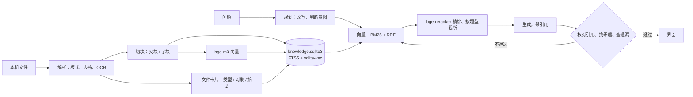

<p align="center">
  
</p>

<h1 align="center">寻寻</h1>

<p align="center">把文件夹交给寻寻，它读完以后回答你的问题，并给出能点开定位的出处。<br>
Windows 桌面知识库 · 文件留在原处 · 免费模型也能答得准</p>

<p align="center">
  <a href="https://github.com/NG666666158/xunxun/releases/latest"><b>下载最新版</b></a> ·
  <a href="CHANGELOG.md">更新记录</a> ·
  <a href="docs/BENCHMARKS.md">评测成绩</a> ·
  <a href="https://github.com/NG666666158/xunxun/issues">反馈问题</a>
</p>

---

## 能做什么

- **问资料里的事**：回答带出处，点一下打开原文并高亮那一段。可以只在选中的文件或文件夹里问。
- **说清楚资料的边界**：
  - 资料里没有你问的那一年、那个地方或那个对象时，回答开头会先说“资料里没有找到…”；
  - 几份资料说法不一致时，会把各自的说法和出处都列出来；
  - 你问的词和资料里的词只差一点（问“质保期”、资料写“保质期”）时，会提醒你。
- **几份资料一起答**：问题涉及几份文件时，先把每份都找到再回答。是 / 否题给出明确结论，问时间先后的题会看文件日期。
- **找文件**：
  - 按内容、名字、时间、类型都能找，比如“找一下我的简历”“有哪些合同”“最近的检测报告”；
  - 文件名里没写类型也能找到，因为寻寻会给每个文件写一张卡片，记下它是什么文件、关于谁；
  - 在任何程序里按 `Alt+Space` 都能弹出搜索框。
- **读整份文件**：“总结一下《X》”会通读全文；“这张表一共多少条”在本机逐格计算。
- **支持的格式**：PDF（包括双栏和表格）、Word、Excel、PowerPoint、Markdown、文本、图片。扫描件和图片可以在本机识别文字。
- **资料库**：
  - 添加文件夹后，里面的变化会自动跟上，改名、移动、删进回收站都能认出来；
  - 每个文件都能看到它的类型和卡片，可以按类型筛选；
  - 涉及隐私的文件夹可以设成“只按文件名收录”，内容不读也不上传。
- **对话和数据安全**：对话记录存在本机，重启后接着问。启动时会检查数据，并自动备份。

评测成绩见 [docs/BENCHMARKS.md](docs/BENCHMARKS.md)。用免费的 Qwen3-8B，在 RGB、MultiHop-RAG 等公开评测集上和论文里的 ChatGPT、GPT-4 做了对比。

## 下载和安装

1. 到 [Releases](https://github.com/NG666666158/xunxun/releases/latest) 下载 `Xunxun_x.y.z_x64-setup.exe`，双击安装。
   - 不需要管理员权限，装在你自己的用户目录下。
   - 系统缺 WebView2 时，安装程序会自动下载。
2. 安装包目前没有代码签名，Windows 可能提示“Windows 已保护你的电脑”：点“更多信息”，再点“仍要运行”。
3. 第一次打开时，跟着引导走：
   1. 看一遍数据去向；
   2. 在[硅基流动控制台](https://cloud.siliconflow.cn/account/ak)新建一个 API Key，填进去并测试；
   3. 选回答用的模型；
   4. 添加第一个文件夹。寻寻会在后台读完它，读的过程中就可以开始提问。

**更新**：设置 › 关于 › 检查更新。新版会从本仓库的 Releases 下载，验证签名后自动安装，资料和对话都会保留。

**从“企业知识库”升级**：之前装过这个名字的旧版，直接安装寻寻即可。安装程序会先卸载旧版，资料、对话和 Key 都保留。固定在任务栏上的旧图标需要重新固定一次。

## 需要什么

- Windows 10 / 11，64 位。
- 能上网，有一个[硅基流动](https://cloud.siliconflow.cn/)账户。目前没有离线模式。

回答用的模型在首次引导里选，之后也能在设置里改：

| 模型 | 费用 | 速度 |
|---|---|---|
| Qwen3-8B | 免费 | 一般问题约 10 秒，长问题和整份总结要更久 |
| Qwen3-30B-A3B | 约 ¥0.006 一题 | 回答更细 |

向量和重排用的 bge-m3、bge-reranker-v2-m3 在硅基流动上也是免费的。免费模型有每分钟的用量上限，限流时寻寻会排队等待，界面上会提示。

## 数据去向

- **只留在本机**：原文件、索引库、对话记录和文件卡片。寻寻只记录文件的位置，不复制原文件。
- **会发给硅基流动**：文档文字、文件名和你的问题，用来生成向量、判断文件类型、排序和回答。
- **图片**：只有选了云端识别才会上传。PPT 里的图片不读，也不上传。
- **可以不上传的文件**：设成“只按文件名收录”，或者设为“不收录”。在文件或文件夹旁边的盾牌按钮里设置。
- **API Key**：存在 Windows 凭据管理器里，不写进任何文件。

| 位置 | 内容 |
|---|---|
| `%LOCALAPPDATA%\寻寻\` | 程序 |
| `%APPDATA%\EnterpriseKnowledgeBase\` | 索引库、对话记录、备份、日志、设置。卸载时不会删除 |
| Windows 凭据管理器 `EnterpriseKnowledgeBase` | API Key |

数据目录的名字沿用了旧版，这样从旧版升级时资料不用搬。

## 常见问题

**要花钱吗？** 软件免费。默认用的模型在硅基流动上也免费，只有你在设置里换成收费模型时才按量付费。

**我的文件会被传到网上吗？** 文件本身不会。被读到的文字会发给硅基流动，用来生成向量和回答。不想发出去的文件夹，设成“只按文件名收录”。

**回答可信吗？** 每句话都标了出处，点开就能看到原文。寻寻会核对回答里的数字和名称是否出自资料。资料里没有答案、只有相近内容时，它会在开头提醒你，但不一定每次都能认出来，关键数字请点开出处看一眼。

**为什么提示“已保护你的电脑”？** 安装包还没有代码签名，Windows 对新软件都会这样提示。点“更多信息”，再点“仍要运行”即可。

**卸载会删掉我的资料吗？** 不会。原文件本来就在你自己的文件夹里；索引和对话记录留在数据目录，重新安装后还在。

**遇到问题怎么办？** 设置 › 关于 › 导出诊断信息，会得到一个 zip，里面是日志和版本信息，可能含文件名，不含 Key 和文档内容。到 [Issues](https://github.com/NG666666158/xunxun/issues) 描述问题，附上这个 zip。

## 已知限制

- 只支持 Windows x64，安装包还没有代码签名。
- 必须联网，并且有硅基流动账户。
- 旧版 `.ppt` 文件需要本机装有 PowerPoint 才能读；PPT 图片里的文字不读；表格问答只支持 10 MB 以内的 `.xlsx`。
- 文件卡片由模型判断，偶尔会标错类型。文件名里写明了类型的，以文件名为准。

## 怎么工作



| 部分 | 实现 |
|---|---|
| 外壳（`desktop/`） | Tauri 2：启动后台、托盘、全局快捷键、原生选择框、自动更新 |
| 后台（`project/`） | FastAPI + LangGraph，用 PyInstaller 打包。只监听 `127.0.0.1`，端口随机，每次启动生成新令牌 |
| 界面（`project/ui/static/`） | 原生 HTML / CSS / JS，不需要构建 |
| 存储 | 一个 SQLite 文件，放文件表、片段、BM25 倒排、向量和文件卡片 |

```text
project/
├── api/         FastAPI 接口和令牌校验
├── core/        应用容器、用户设置、对话存储、数据安全、诊断导出
├── ingestion/   解析、切块、入库，本机 OCR
├── library/     文件表、监控、入库队列、预览
├── rag_agent/   LangGraph 节点、提示词和回答检查
├── retrieval/   SQLite 存储、混合检索、重排、找文件、文件卡片
├── services/    硅基流动客户端
├── suggestions/ 猜你想问、追问建议
├── ui/static/   界面
└── tests/       单元测试（tests/js 是界面逻辑，tests/smoke 是浏览器冒烟测试）
desktop/         Tauri 外壳
packaging/       打包脚本、升级测试、发布流程
evaluation/      评测框架（数据集需自行下载）
design/          设计说明
```

## 从源码运行

需要 Python 3.10、Node.js；打包还需要 Rust。

```bash
python -m venv .venv
.venv/Scripts/python -m pip install -r requirements-lock.txt
cp project/.env.example project/.env   # 填 SILICONFLOW_API_KEY
.venv/Scripts/python project/app.py    # 打开 http://127.0.0.1:8000/ui
```

不想用真实模型时，`project/tests/smoke/serve.py` 会用假的模型服务启动同一个后台：

```bash
.venv/Scripts/python project/tests/smoke/serve.py --port 8110 --data-dir <空文件夹>
```

测试：

```bash
.venv/Scripts/python -m pytest project/tests -q
for f in project/tests/js/*.cjs; do node --test "$f"; done
.venv/Scripts/python -I evaluation/suite/ci_tier.py check
```

打包和发布见 [packaging/README_RELEASE.md](packaging/README_RELEASE.md)，外壳的结构见 [desktop/README.md](desktop/README.md)。

## 许可证和致谢

MIT 许可证，见 [LICENSE](LICENSE)。本项目基于 Giovanni Pasqualino 的 [agentic-rag-for-dummies](https://github.com/GiovanniPasq/agentic-rag-for-dummies)（MIT）发展而来，第三方组件说明见 [NOTICE.md](NOTICE.md)。
